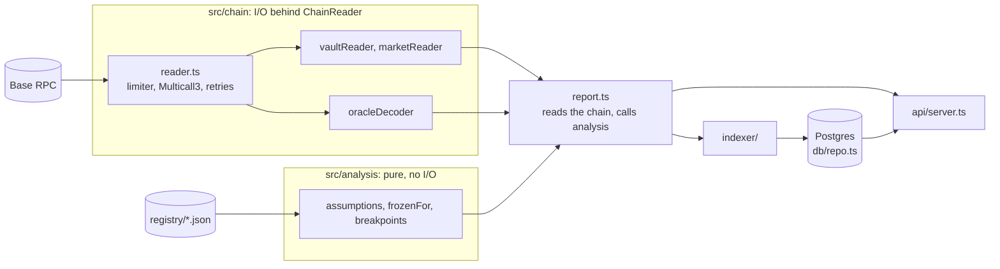
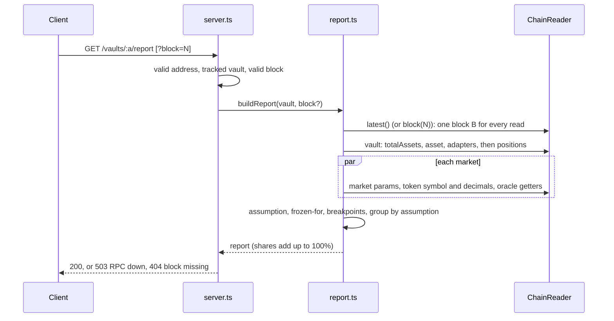
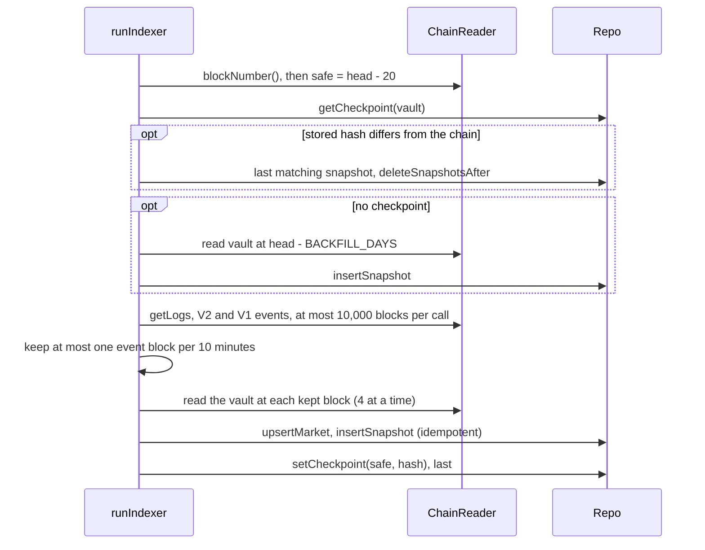
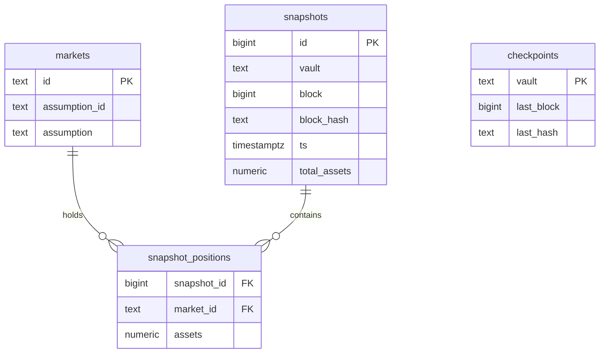

# Architecture

Two paths share one RPC client and one analysis core. **`/report`** reads Base live, at one pinned block. **`/peak`** reads Postgres, which a background indexer fills with snapshots taken at allocation events. The README has the run instructions and the API; this file explains how the code is organised and why.

## Components

| Module | Responsibility | Depends on |
|---|---|---|
| `chain/reader.ts` | `ChainReader` over viem: Multicall3 batching, 3 requests in flight, retry with backoff. A revert returns `null`; any other failure is `RpcUnavailableError`. | RPC |
| `chain/vaultReader.ts` | Vault → adapters (`MorphoMarketV1`, or `MorphoVaultV1Adapter` followed one level into its V1 vault) → positions per market. Reads are grouped by dependency, so time = number of dependent steps. | `ChainReader` |
| `chain/oracleDecoder.ts` | Classifies an oracle: `fixed`, `chainlink`, `metaoracle` (one nesting level) or `unknown` with a reason. | `ChainReader` |
| `analysis/*` | What the oracle assumes (`USDe = 1 USD`), how long it can stay frozen, the two price-drop breakpoints. Pure functions on decoded data and the registry. | none |
| `registry/*.json` | What a feed or token *means*. Missing means `unknown`, never a guess. | none |
| `report.ts` | Assembles a vault report at one block: reads, then calls `analysis`. | chain, analysis |
| `indexer/` | `getLogs` → event blocks → snapshots → checkpoint. | `ChainReader`, `Repo`, `report.ts` |
| `db/repo.ts` | Idempotent snapshot writes, checkpoint, rollback, the peak query. | Postgres |
| `api/server.ts` | Fastify routes, validation, mapping of typed errors to HTTP. | report, `Repo` |
| `main.ts` | Wiring: config, migrations, indexer loop, server, graceful stop. | all |

The chain and the database sit behind two small interfaces (`ChainReader`, `Repo`). Tests swap them for an in-memory chain loaded with real recorded Base answers (`test/helpers/fakeChain.ts`) and an in-memory repo.

## `GET /report`

Everything is read at the same block `B`. Reads at `latest` could straddle two blocks and drift (a 1.8 USDC gap was measured). A market whose oracle or token cannot be read becomes `unknown` with a reason; the rest is still served.

## Indexer pass (every 30 s, per vault)

It is HTTP polling, not a websocket. A failed pass is logged and retried on the next tick. The checkpoint moves last, and snapshots are unique per `(vault, block)`, so a crash only repeats harmless work.

## Data model

- `snapshots` is unique on `(vault, block)`; deleting one cascades to its positions. `block_hash` is what detects a reorg.
- Amounts are `NUMERIC(78,0)`: exact integers, `bigint` in code and strings in JSON, never `number`.
- A market row stores only the assumption its oracle rests on (`NULL` for `none` and `unknown`). `/peak` is one SQL query: per snapshot, the assumption's share of `total_assets`, then the max per assumption.
- Plain SQL migrations, applied once each at startup (`schema_migrations`).

## Failure paths

- **Rate limits:** exponential backoff, at most 3 requests in flight, batching, `getLogs` in chunks.
- **Revert vs outage:** a revert is information ("no such getter"); an outage must never look like one.
- **Reorg:** compare the stored hash with the chain, delete snapshots after the last common block, re-index. Only blocks older than the confirmation depth are indexed.
- **Unknown oracle, token or adapter:** that market, or the money behind that adapter, is `unknown` with a reason code, never counted as `idle`.
- **RPC down:** `/report` answers 503 and old data is never served as current. `/peak` does not need the RPC.

## Trade-offs

| Choice | Why | Cost |
|---|---|---|
| `/report` reads live | The database lags (event blocks, 10-minute windows, 20-block depth); `?block=N` works for any block | A few seconds of latency; needs the RPC |
| Snapshots at event blocks, polled with `getLogs` | The vault only changes at events; one RPC URL, no websocket | `/peak` is a lower bound; 40 to 70 s behind the head (20 blocks plus the poll interval) |
| One snapshot per 10-minute window | Each snapshot is about 90 `eth_call`s (batched into far fewer requests); a busy vault emits hundreds of events a day | An intermediate state inside a window can be the stored one |
| Windows from block numbers (2 s per block) | No `getBlock` per event | Approximate if Base changes its block time |
| Postgres | Relational data, exact integers, the peak is one aggregate | A service to run |
| Registry in the repo | A wrong meaning is worse than a gap; changes are reviewed in PRs | Manual upkeep |
| Indexer and API in one process | Simple to run | They share one RPC client, so `/report` slows during a backfill |

## What would change at scale

Run the indexer as its own process, with its own RPC client. Cache decoded oracles per market (market parameters are immutable; oracles are roughly half of the 86 calls of a report). Track the MetaOracle state in history to alert on challenges (see "With more time" in the BusinessCase).
